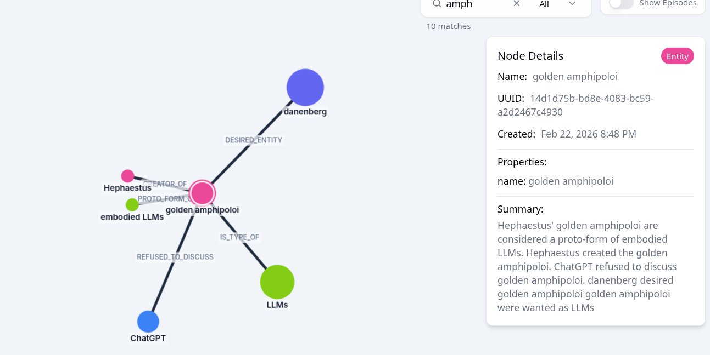

# zep-mcp

Minimal MCP memory server -- three tools, `add_memory`, `search_memory` and
`list_memory`, over one of two backends chosen by `ZEP_MCP_BACKEND`:

- `zep` (default): [Zep Cloud](https://www.getzep.com/), a temporal knowledge graph.
- `own`: our own store, Postgres + pgvector with Voyage embeddings and
  reranking and a use log per fact, built to replace Zep
  ([plan](plans/2026-10-20-own-memory-store.md),
  [phase 1](plans/2026-10-21-own-memory-store-phase1.md)). Not live yet.

Zep Cloud is built on [Graphiti](https://github.com/getzep/graphiti), an
open-source temporal knowledge graph framework. Unlike flat memory stores,
Zep extracts entities and relationships from text, tracks how facts evolve
over time (valid/invalid timestamps), and supports hybrid search (semantic
+ BM25 keyword + graph traversal).



## Tools

| Tool | Description |
|------|-------------|
| `add_memory(content, source="")` | Store a fact. `source` is optional provenance, a JSON object as a string (`app`, `conversation` or `session`, `model`, `tools`, `turn_time`). Zep: an episode, with `source` as its source_description and metadata; own: one row, `source` on it. |
| `search_memory(query, limit=5)` | JSON list of `{text, relevance, created_at}` (own adds `valid_from` when known). Zep: edges by cross-encoder. Own: nearest 50 by cosine, rerank-2.5, then MMR so rewordings of a fact already returned are left out. |
| `list_memory(limit=50)` | Most recent first, `N. [date] text`. Zep: episodes; own: facts. |

## Setup

```bash
# Install as a tool (recommended)
uv tool install "git+https://github.com/klutometis/zep-mcp.git"

# Or clone for development
git clone https://github.com/klutometis/zep-mcp.git
cd zep-mcp
uv sync
```

## Usage

### Standalone (stdio)

```bash
ZEP_API_KEY=z_... ZEP_USER_ID=danenberg zep-mcp
```

### With uvx (no install needed)

```bash
ZEP_API_KEY=z_... ZEP_USER_ID=danenberg \
  uvx --from "git+https://github.com/klutometis/zep-mcp.git" zep-mcp
```

### With MCP Inspector

- Transport: **STDIO**
- Command: `uvx`
- Args: `--from git+https://github.com/klutometis/zep-mcp.git zep-mcp`
- Env: `ZEP_API_KEY`, `ZEP_USER_ID`

### With an MCP gateway / client config

```json
{
  "zep": {
    "command": "uvx",
    "args": [
      "--from", "git+https://github.com/klutometis/zep-mcp.git", "zep-mcp"
    ],
    "env": {
      "ZEP_API_KEY": "z_...",
      "ZEP_USER_ID": "danenberg"
    }
  }
}
```

## Environment variables

| Variable | Required | Description |
|----------|----------|-------------|
| `ZEP_MCP_BACKEND` | No | `zep` (default) or `own` |
| `ZEP_API_KEY` | zep backend | Zep Cloud API key (starts with `z_`) |
| `ZEP_USER_ID` | No | User ID for scoping memory, both backends (default: `"default"`); per-request W3C baggage overrides it |
| `MEMORY_DATABASE_URL` | own backend | Postgres with pgvector; today the llm-multiplex Neon database, schema `memory` |
| `VOYAGE_API_KEY` | own backend | Voyage AI key (voyage-4-large, rerank-2.5) |
| `MEMORY_SCHEMA` | No | own backend schema (default `memory`) |
| `MEMORY_MMR_LAMBDA` | No | MMR relevance/novelty trade-off, 0..1 (default 0.5; 1 = pure rerank order) |
| `MEMORY_SEARCH_POOL` | No | nearest neighbours reranked per search (default 50, max 200) |

The server creates the Zep user on startup if it doesn't exist (idempotent).

## The own backend

Tables, in schema `memory` (DDL in `zep_mcp/store.py`, applied by the
migration, never by the server):

| Table | |
|---|---|
| `memories` | `id, user_id, text, embedding vector(1024), created_at, valid_from, source jsonb, zep jsonb, zep_uuid, merged_into`; HNSW (`vector_cosine_ops`) on `embedding` |
| `memory_uses` | `memory_id, at, kind (saved, restated, retrieved), context jsonb`: the history ACT-R activation is computed from |
| `zep_episodes` | the texts originally saved to Zep, for provenance |

Nothing is deleted or archived: a merged fact points at the survivor through
`merged_into`, and forgetting will be a threshold on ACT-R base-level
activation, applied at query time. Activation, `ln Σ t^-0.5` over a fact's
uses, is computed for every search candidate and logged with each `retrieved`
use, with no weight in ranking yet.

Migration from Zep (read-only on Zep, idempotent on our side):

```bash
uv run python scripts/migrate_from_zep.py export --out $TMPDIR/zep-export
MEMORY_DATABASE_URL=... uv run python scripts/migrate_from_zep.py load --snapshot $TMPDIR/zep-export
# later, a catch-up sync before switching: fresh export, then load --refresh-zep
```

Offline comparison with Zep (read-only; output is personal, so it goes to
`$TMPDIR`, never the repo): `uv run python scripts/evaluate.py`.

Tests: `uv run pytest`. With `MEMORY_DATABASE_URL` and `VOYAGE_API_KEY` set,
the integration tests run against a throwaway `memory_test_*` schema.

## Importing memories into Zep

A migration script is included for importing from OpenMemory (or any JSON
array of `{"content": "..."}` objects):

```bash
ZEP_API_KEY=z_... ZEP_USER_ID=danenberg \
  uv run python import-memories.py /path/to/export.json
```

Options:

| Flag | Description |
|------|-------------|
| `--nuke` | Delete user and recreate before importing (clean slate) |
| `--delay N` | Seconds between API calls (default: 0.5) |
| `--resume N` | Skip first N records (resume after partial import) |

## Architecture

```
Zep Cloud (Graphiti engine)          This server              Your client
┌────────────────────────┐      ┌──────────────────┐      ┌──────────────┐
│  Temporal knowledge    │      │  zep_mcp.py      │      │  Claude,     │
│  graph: entities,      │◄────►│  (FastMCP, stdio) │◄────►│  gateway,   │
│  relationships, facts  │      │  3 tools         │      │  Inspector   │
└────────────────────────┘      └──────────────────┘      └──────────────┘
         HTTPS                         stdio
```
